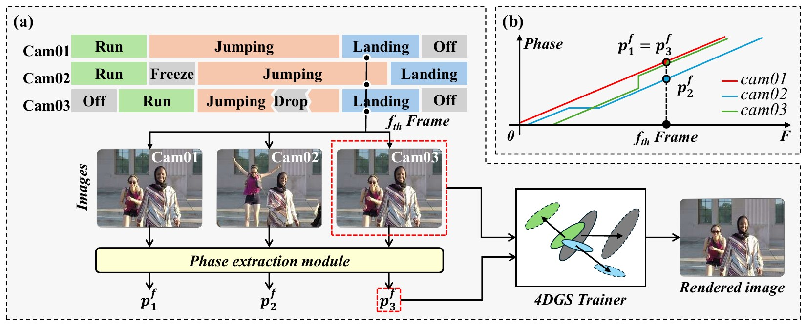
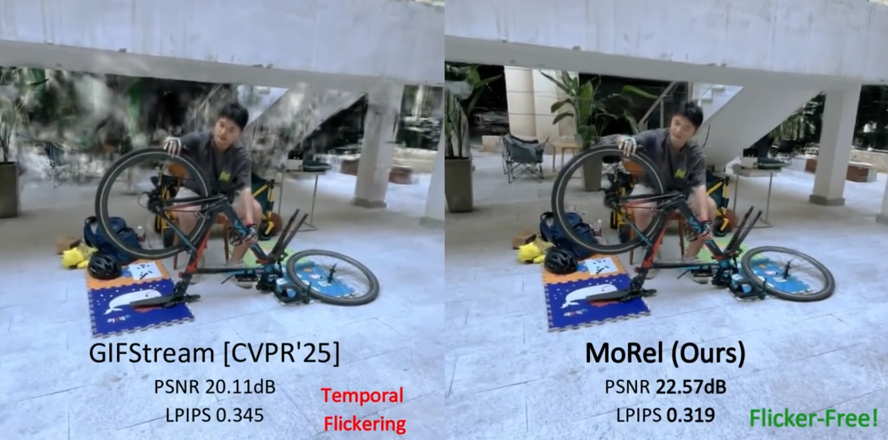
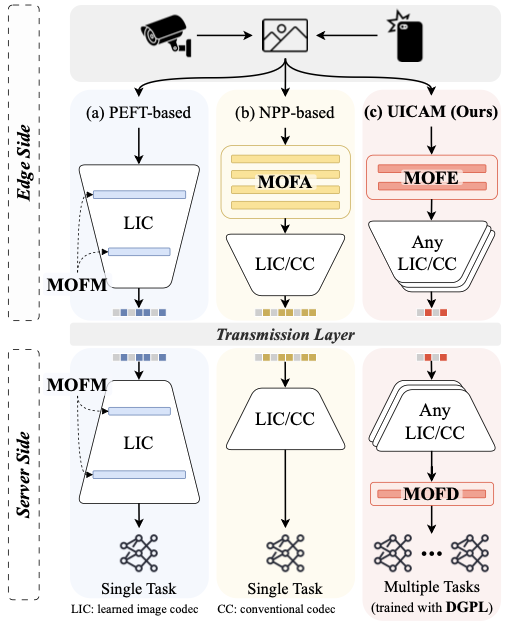
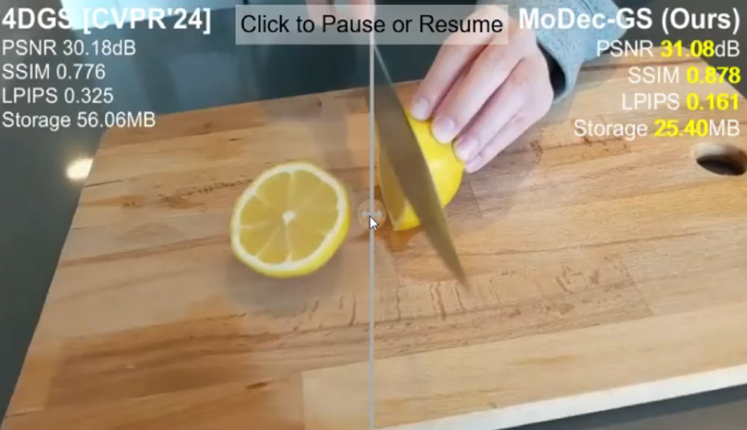
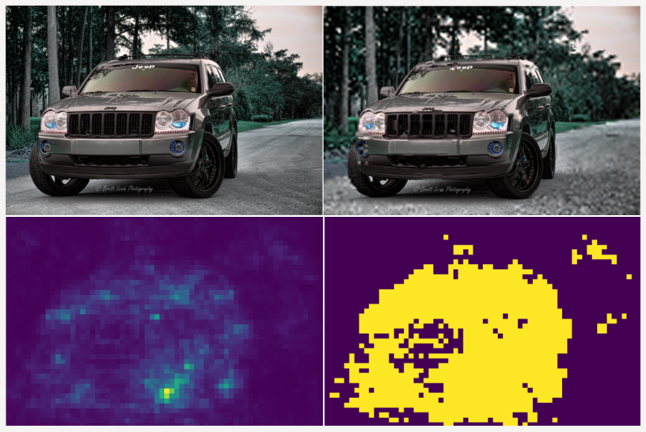
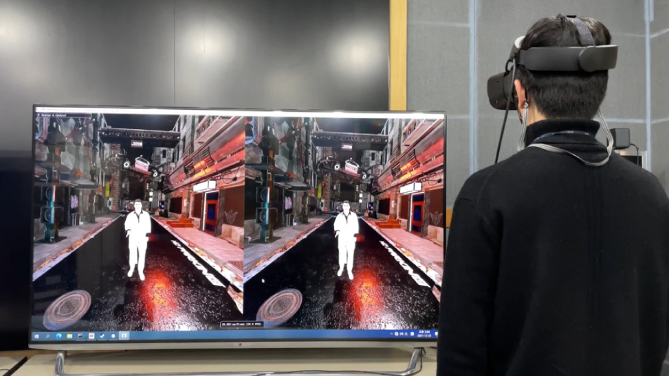

I am a Senior Researcher at the Media Research Division of the
<b>ETRI</b>, based in Daejeon, Korea.
I received my Ph.D. in Electrical Engineering from
<b>KAIST</b>, advised by
Prof. Munchurl Kim (<a href="https://www.viclab.kaist.ac.kr/">VICLab</a>).

My research lies at the intersection of
<b>immersive video</b> and
<b>computer vision</b>, with a focus on
3D/4D scene representation, novel view synthesis, and video coding for
machines (VCM). I am particularly interested in efficient and
application-friendly 3D/4D Gaussian Splatting for immersive media services
of real-world videos.

You can reach me at s.kwak [at] etri.re.kr.

Education
======

  
  

    Ph.D. in Electrical Engineering, KAIST 
    Advisor: Prof. Munchurl Kim (<a href="https://www.viclab.kaist.ac.kr/">VICLab</a>)
  

  
Mar. 2021 &ndash; Feb. 2026

  
  

    M.S. in Electrical Engineering, KAIST 
    Advisor: Prof. Youngchul Sung (<a href="https://sites.google.com/view/sisrelkaist">SISReL</a>)
  

  
Mar. 2012 &ndash; Feb. 2014

  
  

    B.S. in Electrical and Electronic Engineering, Yonsei University 
    National Science &amp; Engineering Scholarship (Full tuition)
  

  
Mar. 2008 &ndash; Feb. 2012

Experience
======

  

    
    

      Senior Researcher, Media Research Division, ETRI
    

    
Mar. 2014 &ndash; Present

  

  <ul style="margin:0; padding-left:24px; font-size:0.9em;">
    <li>Spatial Computing Technologies for ultra-realistic metaverse services (MIV, NeRF, 3DGS) [<a href="https://www.youtube.com/watch?v=uzxlxQRPT4g">video</a>]</li>
    <li>Video Coding for Machines (international standardization at ISO/IEC JTC1/SC29 MPEG)</li>
    <li>Light field view synthesis &amp; rendering for 6DoF immersive video [<a href="https://www.youtube.com/watch?v=GlxDzBjNrI0&feature=youtu.be">video</a>]</li>
  </ul>

Selected Publications
======

  
  

    
Phase-DGS: Phase-guided Dynamic Gaussian Splatting from Unsynchronized Multi-view Video

    
H. Jeon&dagger;, J. Jeong, <b>S. Kwak</b>&dagger;, J. Kim, S. Kim, J. Park, W.-S. Cheong, H. Choo (&dagger; Co-corresponding authors)

    
<i>NeurIPS</i>, 2026

    

      🌐 <a href="https://oc-dev74.github.io/Phase-DGS/">Project Page</a> &nbsp;|&nbsp;
      📄 <a href="https://arxiv.org/abs/2611.04666">arXiv</a>
    

  

  
  

    
MoRel: Long-Range Flicker-Free 4D Motion Modeling via Anchor Relay-based Bidirectional Blending with Hierarchical Densification

    
<b>S. Kwak</b>*, W. Kwon*, J. Jeong, G. Kim, W.-S. Cheong, J. Oh&dagger; (* Equal contribution, &dagger; Corresponding author)

    
<i>CVPR</i>, 2026
      &nbsp;⭐ Highlight
    

    

      🌐 <a href="https://cmlab-korea.github.io/MoRel/">Project Page</a> &nbsp;|&nbsp;
      📄 <a href="https://arxiv.org/pdf/2512.09270">arXiv</a> &nbsp;|&nbsp;
      💻 <a href="https://github.com/CMLab-Korea/CVPR26-MoRel">Code</a> &nbsp;|&nbsp;
      🎥 <a href="https://www.youtube.com/watch?v=r8KNhreRf3Q">Video</a>
    

  

  
  

    
UICAM: A Codec-Transferable Adapter for Machine-Oriented Image Compression

    
S. Jeong, <b>S. Kwak</b>, S. Jung, H. Choo, J. Ko

    
<i>IEEE AVSS</i>, 2026

  

  
  

    
MoDec-GS: Global-to-Local Motion Decomposition and Temporal Interval Adjustment for Compact Dynamic 3D Gaussian Splatting

    
<b>S. Kwak</b>, J. Kim, J. Jeong, W.-S. Cheong, J. Oh&dagger;, M. Kim&dagger; (&dagger; Co-corresponding authors)

    
<i>CVPR</i>, 2025

    

      🌐 <a href="https://kaist-viclab.github.io/MoDecGS-site/">Project Page</a> &nbsp;|&nbsp;
      📄 <a href="https://arxiv.org/abs/2501.03714">arXiv</a> &nbsp;|&nbsp;
      💻 <a href="https://github.com/skwak-kaist/MoDec-GS">Code</a> &nbsp;|&nbsp;
      🎥 <a href="https://www.youtube.com/watch?v=5L6gzc5-cw8">Video</a>
    

  

  
Figure coming soon

  

    
Tracking-based Adaptive Temporal Resampling for Video Coding for Machines

    
E. An, M. Kim, K. Seo, <b>S. Kwak</b>, A. Kim, S. Jung, H. Choo

    
<i>IEEE AVSS</i>, 2025

    

      📄 <a href="https://doi.org/10.1109/AVSS65446.2025.11149979">Paper</a>
    

  

  
  

    
Feature-Guided Machine-Centric Image Coding for Downstream Tasks

    
<b>S. Kwak</b>, J. Yun, H. Choo, M. Kim&dagger;

    
<i>IEEE ICMEW</i>, 2023

    

      📄 <a href="https://ieeexplore.ieee.org/document/10222720">Paper</a>
    

  

  
  

    
View Synthesis with Sparse Light Field for 6DoF Immersive Video

    
<b>S. Kwak</b>, J. Yun&dagger;, J.-Y. Jeong, Y. Kim, I. Ihm, W.-S. Cheong, J. Seo

    
<i>ETRI Journal</i>, 2022

    

      🎥 <a href="https://www.youtube.com/watch?v=GlxDzBjNrI0&feature=youtu.be">Video</a>
    

  

